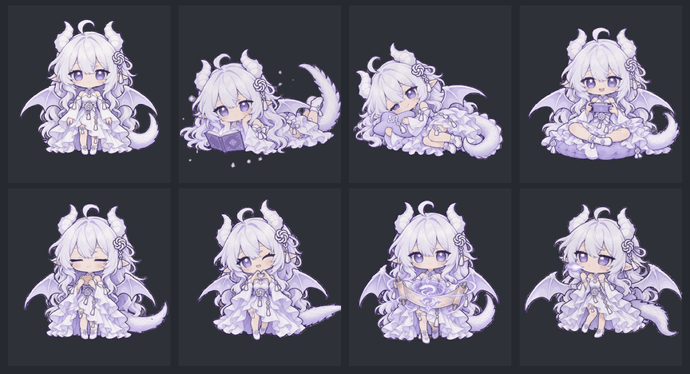
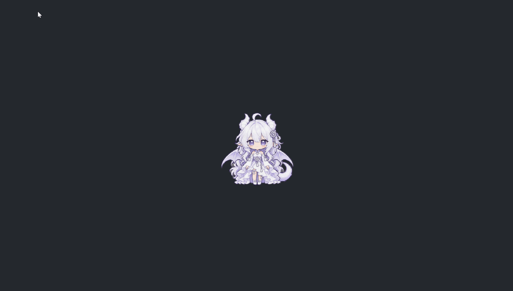

# GPT 白龙娘桌宠

开发中的非官方桌宠项目。当前 Windows 开发版支持更换角色素材，并可连接 ChatGPT 桌面客户端。

## Windows 开发期功能展示

### 基本动作

透明动画来自独立的 v2 PNG 素材包。清单将待机、互动等行为绑定到包内动作，换包后可以沿用相同的交互方式，呈现不同的角色与动作变体。 [素材协议](docs/development/runtime-v2.md#引擎行为语义)

  

### 自主移动

桌宠根据当前屏幕工作区的可用空间选择移动方向。全动作包提供走、跑、飞等变体，并支持垂直方向的移动（使用飞行语义素材动作）。

  

### 快捷操作与信息速览

右键打开快捷栏，双击查看已连接的 ChatGPT 账户套餐和 Codex 额度。浮层以角色位置为锚点，拖动时随角色移动，吸边后也会重新定位。Windows 面板使用 WinUI 3，快捷栏和速览采用系统 Acrylic 材质。 [面板设计](docs/design/panels.md)

  

### 设置窗口

Windows平台的设置窗口采用系统 Mica 材质，设置窗口中提供全部配置项。缩放等调整可以先预览，关闭窗口会撤销未应用的修改。

开发构建读取启动目录里的 `desktop-pet.dev.toml`，面板改动仅用于本次运行。产品构建把偏好保存到用户目录下的 TOML 配置文件。 [配置设计](docs/development/runtime-v2.md#配置与启动)

  

## 构建与运行

当前版本从源码运行，需要本地 v2 PNG 素材包，清单须声明 `engine_api = 2`。 [构建与运行](docs/development/workflow.md) · [使用与配置](docs/user/guide.md) · [素材工作区](assets/README.md)

## 后续开发目标

- **聊天窗口**优先验证与 Windows ChatGPT 客户端在同一会话中收发消息，再接入会话选择、消息阅读和流式回复。同会话能力是首次正式发布的门槛之一。
- **多平台**从选定的 Linux 桌面环境开始，复用素材协议、配置和行为逻辑，适配桌面渲染、输入和面板。
- **DeepSeek Harness（DSH）**：先接入桌面版的独立连接和只读查询，对话能力按客户端接口验证结果推进。

[路线图](docs/plan/roadmap.md) · [开发文档](docs/README.md)

## 许可

源码尚未指定开源许可证。第三方组件遵循各自许可证。

本仓库是基于上游项目进行技术研究与改进的非官方 fork。本仓库尚未收到原作者（[bilibili @風-隐，UID 290239611](https://space.bilibili.com/290239611)）的明确授权。我们尊重原作者及相关权利人的权益，不将未回复视为授权，也不据此推断作者拒绝引用。角色、美术、动画、音效及其转换版本的权利范围尚待逐项确认；本仓库不因公开展示、技术修改或署名而额外授予这些资源的使用、修改、商用或再分发许可。上游代码的许可状态与第三方软件许可另行说明。如权利人对相关内容有疑问，我们愿意沟通核实，并据核实结果调整展示、分发或移除相关内容。本项目非 OpenAI 官方产品。
