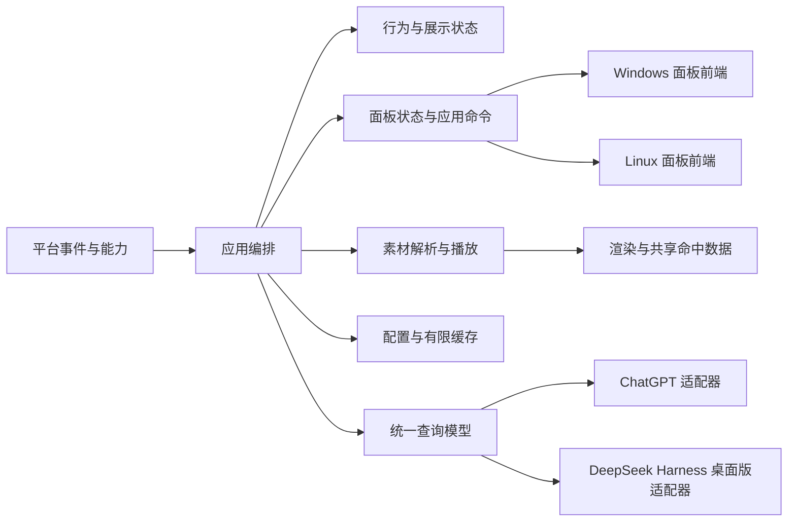

# 目标架构与渐进重构

状态：目标架构提案，面板的平台边界已确认。沿用 Rust、纯逻辑与有界媒体设计，现有 Windows 角色路径继续使用 winit/wgpu。Windows 和 Linux 可以使用独立的面板前端。现有 Windows 路径在每个重构切片都须可运行。

## 边界与所有权

| 边界 | 输入 / 输出与责任 | 禁止依赖 |
| --- | --- | --- |
| core | 单调时间、手势、逻辑工作区、语义动作 → 状态、效果、下一截止时间 | OS 句柄、GPU、文件、客户端私有 schema |
| app | 组装服务，路由事件，持有生命周期及配置快照 | 直接解析远端协议、在事件线程长时间解码/查询 |
| platform | 平台能力、窗口位置/命中/托盘/自启/用户目录、坐标转换 | 角色名、动作文件名、账户业务 |
| media | 清单与绑定 → 时间线、帧页、画布与命中输入；有界后台读取 | Win32 region、账号状态 |
| render | 纹理页和画布 → 呈现；surface/device 恢复 | 业务动作选择、直接文件读取 |
| integrations | 探测/查询 → 带来源的快照；各客户端独立限流和缓存 | 控制桌宠窗口、直接修改外部数据 |
| storage | 校验、原子写、迁移、有限缓存与日志 | 读取外部客户端私有 DB 的业务逻辑 |
| ui | 共用面板状态、导航、客户端视图模型和应用命令。各平台前端负责控件、焦点和窗口生命周期 | 阻塞查询、自行推断能力或权限、在共享模型中存放窗口句柄或控件对象 |

建议继续单进程、多 worker；先用窄数据结构和具体实现隔离，不为每个函数建立 trait。第二个真实实现出现时再提炼共有接口。不要因为两个客户端就引入脚本插件系统、动态库 ABI 或常驻守护服务。

## 平台能力必须进入模型

拟定能力包括：透明呈现、轮廓输入区域、程序定位、置顶、工作区查询、同屏全屏检测、托盘、通知、自启、显示缩放。每项返回 `Supported / Limited(reason) / Unavailable(reason)`；动作执行仍可能失败，调用方不能把探测结果当保证。

| 环境 | 计划与约束 | 需要真实验收的内容 |
| --- | --- | --- |
| Windows | 角色继续使用现有 Win32 / DX12 路径。面板单独验证 WinUI 3 / Reactor | 混合 DPI、负坐标、断屏、托盘重建、面板焦点、休眠与恢复 |
| Linux X11 | 可作为第一个 Linux 完整行为候选，尚未实现 | 合成器透明、输入区域、窗口管理器定位/置顶、托盘与全屏检测 |
| Linux Wayland | 先选具体桌面/合成器；区分标准窗口与可用扩展 | 定位、自移动、吸边、置顶和托盘缺失时的替代交互 |

Wayland 的窗口管理不能直接复用 Win32 全局坐标命令。layer-shell 定义了锚点、层级等机制，但它是另一套协议，不能据此断言所有桌面都提供同等能力。实现前按目标合成器公布的协议和实机结果建矩阵；这是本项目的平台设计判断。[layer-shell 协议原文](https://github.com/swaywm/wlr-protocols/blob/master/unstable/wlr-layer-shell-unstable-v1.xml)

候选降级：无法程序定位时禁用自主移动/吸边，保留手动交互的角色窗口或固定停靠模式；无法取得可靠全屏状态时关闭自动隐藏；缺托盘时提供可恢复的控制窗口。维护者若要求某一 Wayland 环境的完整自由桌宠，应另立专用后端切片，不能把降级窗口标成完整支持。

跨平台坐标统一使用逻辑尺寸、屏幕标识及平台返回的可用区域；物理像素只在渲染/命中边界转换。EDID 是可选的首次尺寸增强，不能成为 Linux 启动依赖。字体使用平台字体解析或许可明确的随附字体；不能把 Windows 字体路径带到 Linux。

## 面板前端边界

应用持有选中客户端实例、查询快照、已确认偏好及用户任务状态。面板读取视图模型并发出打开详情、刷新、应用设置等命令。平台前端处理临时浮层、独立窗口、键盘焦点、坐标和主题。托盘与面板共用应用命令，布局各自维护。客户端专属页面使用各自的数据和能力，沿用共用导航与连接状态。

Windows 允许按需初始化独立面板前端，Linux 可选另一套控件与窗口实现。两端依据同一套[面板行为](panels.md)验收。设置、临时浮层及长期会话分别维护各自的可见性，应用统一管理退出和任务生命周期。

## 资源、线程与退出

角色窗口和 GPU 继续由现有事件线程管理。若候选面板框架要求独立 UI 调度，前端在其所属线程管理窗口，通过应用命令和视图快照交换状态，验证打开、焦点转移、关闭和退出的协调。媒体、客户端查询、后续持久化各自承担阻塞工作。帧结果带 source_id + generation，客户端结果带 provider_instance + connection_epoch + request_id，重新选包或断连后丢弃旧结果。

首发查询按客户端实例最多一个活动刷新；重复刷新合并，不积累任务。窗口关闭不等于取消后续对话任务，后者在对话专项定义。错误、取消与退出不排在大量进度事件后面。

单页 CPU/GPU 上限仍是硬边界；将同步 GPU 等待从交互热路径移走是候选优化，不先无限增大缓存。共享设备、两槽纹理、缓存命中 mask 等方案须有归因数据。统一画布变换同时驱动呈现与命中，不能为加速造成点击区域漂移。

退出停止接收新任务，撤销请求代次，有界等待自有 worker，持久化已确认状态，再销毁窗口。拟定总退出期限 5 秒；当前通用 worker 回收仅等待约 100 ms，须显式审查哪些任务可以放弃、哪些需要可靠完成，不应把旧草案当现状。

## 存储边界

Windows 暂保留已有用户目录，避免无收益迁移。Linux 拟按 XDG 区分配置、数据、状态、缓存和运行时文件；目录不可写或环境变量非法时给出明确错误/规定回退。日志与水位属于状态，角色包属于数据，可再生帧缓存属于缓存。[XDG Base Directory 规范](https://specifications.freedesktop.org/basedir/latest/)

首发基础查询无需先实现聊天数据库；默认只保留有限快照与更新时间，不记录会话正文和凭据。开发模式需要显式隔离的配置根与可复现实验参数。发布默认与开发默认不得因工具路径变化而悄然不同。

## 实施顺序

1. 从平台 cfg 中抽出 core、配置模型、媒体时间线；在 Windows 回归通过后增加 Linux 纯逻辑测试。没有 GUI 的测试不能记为 Linux 桌面完成。
2. 收拢路径、字体、窗口菜单/恢复能力和呈现后端选择，保留当前 Windows 实现。
3. 引入真实 ChatGPT 只读查询切片，验证 UI 与 provider 模型；第二适配器先用有限假数据测试隔离，再接 DSH。
4. Linux 在选定桌面完成“启动→拖动/替代交互→设置→恢复→退出”，再补可用的自动行为。

Windows 面板选型按交互、部署和性能验证推进。Linux 角色后端与面板前端按目标桌面分别选型。角色渲染架构可依据目标环境支持和实测成本单独评估。
