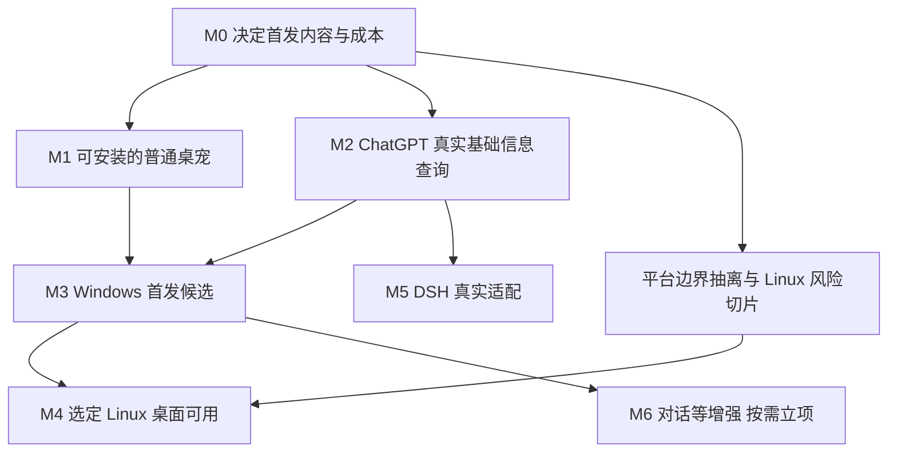

# 后续实施主线

状态：本轮重规划提案；首发范围已确认，具体预算和协议选择待决。起点是当前可运行 Windows 普通桌宠，不重走 P0–P2。里程碑按用户能够完成的事情定义，不按“验证了多少技术”定义。

## 顺序与依赖

图中的并行仅表示依赖允许；单人实施默认一次一条主线，风险切片限时插入。M4 与 M5 的顺序由维护者选择；M6 在首发后另选优先级，不强制依赖 Linux 和 DSH 均完成，也不能反过来阻塞首发。

## 交付卡

| 节点 | 前置与具体工作 | 可审阅交付物 / 完成条件 | 未通过如何处理 |
| --- | --- | --- | --- |
| M0 设计收口 | 选择 D01–D07 中阻塞项；确认真实客户端版本、至少一个业务字段候选、默认动作表、质量/成本档、Linux 目标环境 | 一页首发范围；素材内容清单；查询来源记录；预算决议；首个开发切片任务卡 | 字段不可得须改范围决定；不继续堆完整包或先建聊天系统 |
| M1 普通桌宠可交付 | 基于已有原型精简默认包，完成选择包→校验→重启应用→坏包恢复。拆分角色快捷面板、托盘和设置入口，按 E1/E3 调查性能 | 可安装 Windows 开发附件。默认与第二素材包可用，快捷设置、隐藏恢复、动作和独立设置均通过回归 | 明确画质和成本取舍，完整包可独立提供 |
| M2 基础信息查询 | 接口调查可先于 M1 完成。锁定 ChatGPT 实例与字段，实现适配器、双击速览、功能中心详情、刷新、缓存时效与降级 | 真实客户端诊断和至少一个认可业务字段。断连、认证、超时、过期、切实例、展开详情各有验收路径 | 假适配器用于测试。可靠接口缺失时回 M0 调整首发范围 |
| M3 Windows 首发候选 | M1、M2；自动检查、装配清单、版本/兼容/来源台账；干净机和长时验证 | 默认 feature 的独立附件；离线普通桌宠、真实查询、已选预算、已声明设备范围、升级回退通过 | 阻塞项留在候选，不称正式完成；减少支持范围须更新公开说明 |
| M4 Linux 普通桌宠 | 选定发行版、桌面、会话与架构。完成呈现、输入、恢复、面板、设置、字体、目录和打包。面板可独立实现 | 一个声明清晰的 Linux 实机附件。提供完整与降级能力矩阵，断连时普通功能仍可用 | Wayland 能力受限时选择对应降级交互或专用后端，按实机路径结项 |
| M5 DSH 信息查询 | 基于 M2 的模型核实 DeepSeek Harness 桌面版及接入方式，实现真实适配器与专属页面 | 速览和功能中心可选 DSH，至少一个真实业务字段，来源、实例与查询故障相互隔离 | 按 DSH 实际能力安排字段与操作，检查共享逻辑能否容纳客户端差异 |
| M6 对话及更多增强 | 明确用户价值与接口可行性，另定范围 | 一次只做一条完整路径：对话、任务提醒、额度增强等；含数据/权限/取消边界 | 不让未选的增强变成所有平台和素材的前置 |

M0 是一次设计决议和有限接口调查，不是新的长周期“基础验证阶段”。M1 与 M2 都必须交付能操作的程序，避免直到若干阶段结束才再看到产品增量。

Windows 面板更换作为 M1/M2 的独立候选实现验证。先通过实际面板验证焦点、事件循环、窗口行为及运行时成本，再按 D27 选择首发使用的前端。现有前端可以继续承载交互切片。Linux 的面板实现随 M4 交付。完整会话流与迷你对话随 M6 的对话切片排期。[面板与窗口交互](../design/panels.md)

## 下一轮可以直接领取的任务

| 顺序 | 任务 | 范围、证据与停止条件 |
| --- | --- | --- |
| 1 | ChatGPT 接入来源调查 | 维护者确认客户端版本/实例；只调查安装/连接信息与两个业务字段候选，产出真实脱敏样本、权限与兼容结论。建议上限 2 个专注开发日；无路径就形成决策，不写完整适配框架 |
| 2 | 默认包内容与成本选择 | 列出必需语义、可选预览、分辨率；E1 对照 320/480/720，E3 设置开销归因。建议上限 3 个专注开发日；优先选现成方案，不再全量做每个配方 |
| 3 | 平台边界最小抽离 | 移出 core/配置模型的 Windows 编译门控，注入路径和时间；Windows 测试与 Linux 纯逻辑测试实际运行 |
| 4 | M2 首个纵向切片 | 从真实读取到信息面板；先手动刷新一个业务字段，再加错误/过期、第二实例隔离；完成即提供开发构建 |
| 5 | M1 默认安装与换包闭环 | 合并已选素材与预算方案、设置/菜单整理、包导入和恢复；不能等待对话设计 |

以上时间是调查上限提案，不是交付工期承诺；人员和目标设备未定，不编造完整日历。每次开始任务写清“目标、非目标、涉及边界、预期产物、验收命令/场景、停止条件”；完成后只把稳定结论回写设计，过程留在任务/PR/附件。

## 工程工作穿插方式

PR 自动检查、脱敏诊断、配置/素材兼容、版本清单随着对应切片交付；不再设一个没有用户结果的巨大工程规范阶段。性能门槛在 M0 选择、M1 验证、M3 复验，不能拖到发布前才发现成本不可接受。

平台能力边界在 M1/M2 改动时逐步抽离，Linux 选定环境的透明窗口/输入/恢复风险应在 M3 之前做有限切片，以便发现架构不适配；Linux 正式支持与发布仍在 Windows 首发之后。

## 每次合并与发布的验收

合并：受影响的逻辑/契约自动测试、需要时的 GUI 回归、文档与行为一致；无关设备专项不阻塞普通修改。发布：实际默认包全部动作、安装/坏包/离线/设置/隐藏恢复、真实集成、目标设备、性能和回退全部有对应证据。

硬阻塞包括数据破坏、不可恢复的隐藏/退出、来源/实例串数据、未知字段伪装为真实数据、声明范围内的关键行为失败。缺硬件的场景记未验证，只能缩小声明范围或继续补测，不能记通过。
