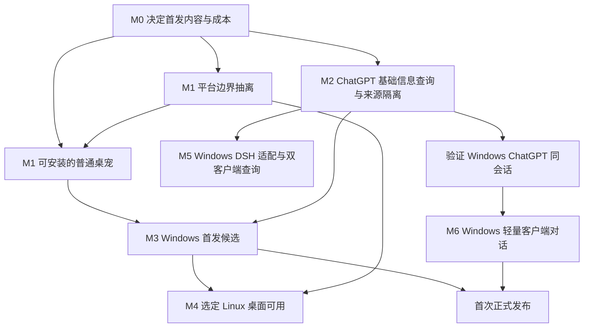

# 后续实施主线

M1 已完成本机开发验收。M2 的 Windows ChatGPT 连接默认启用，速览打开时自动查询套餐和 Codex 额度。合成第二来源已用于验证并列展示、详情切换和来源隔离。早期 M2 构建已实测真实客户端退出与重开，现行构建复验了默认启用和首次自动查询。网络断连仍待验证。 [M2 工程验证记录](validation.md#m2-windows-默认连接与自动刷新)

M6 的 Codex 同会话实验已验证单次发送、文字流、停止和探针重连。属主队列通过双连接同时提交、桌面发送交错、按 ID 取消和未提交预留跨重启。两次完成提交确认丢失后均回查到唯一完成轮次，实时探针在两次实验中均超时。直接双写入仍会合并轮次并残留占位。2026-11-19 因现场网络不稳定暂停实测。 [M6 实验记录](validation.md#2026-11-18-队列确认丢失取消与重启)

M1 以开发验收收尾，交付附件与发布均暂缓。首次正式发布另设 Windows ChatGPT 客户端集成门槛，包含通过桌宠对话。M3 保留 Windows 候选的工程验收动作，正式发布条件见[发布管理](../development/release.md#首次正式发布门槛)。

## 顺序与依赖

图中的并行表示依赖允许。单人实施默认一次一条主线，风险切片限时插入。M4 与 M5 的顺序由维护者选择。Linux 的两个客户端适配器在目标桌面及相应客户端版本确认后分别安排。M3 候选验证与 Windows ChatGPT 同会话验证可独立推进，两条路径都通过后再进入首次正式发布。增强能力按接口实测排期。

## 交付卡

| 节点                          | 前置与具体工作                                                                                                        | 可审阅交付物 / 完成条件                                                                                                                  | 未通过如何处理                                                                 |
| ----------------------------- | --------------------------------------------------------------------------------------------------------------------- | ---------------------------------------------------------------------------------------------------------------------------------------- | ------------------------------------------------------------------------------ |
| M0 设计收口                   | 确定首个切片涉及的决策；验证客户端版本与至少一个业务字段候选；确定默认动作表和质量/成本档                             | 一页首发范围；素材内容清单；查询来源记录；记录性能目标；首个开发切片任务卡                                                               | 可靠字段或连接对象无法确定时，重新确认首发范围                                 |
| M1 普通桌宠开发验收           | 用已验证的 v2 读取、制备和恢复能力完成选择包→校验→重启应用。拆分角色快捷面板、托盘和设置入口，验收 WinUI 3 正式面板 | 默认与第二份 v2 素材包可用，快捷设置、隐藏恢复、动作和独立设置均通过本机回归                                                             | 明确画质和成本取舍，39 动作包供独立开发验证                                    |
| M2 基础信息查询与来源隔离     | 通过 Windows Codex App Server 查询套餐和 Codex 额度，按来源管理连接、刷新、缓存、速览和详情 | 实测套餐、额度、重启、认证、超时和过期。用合成来源验收并列展示、详情切换、缓存及迟到响应隔离 | 断网验收后置。真实双客户端验收随 M5 完成 |
| M3 Windows 首发候选           | M1、M2；自动检查、装配清单、版本/兼容/来源台账；干净机和长时验证                                                      | 默认 feature 的独立附件；离线普通桌宠、真实查询、已声明设备范围和升级回退通过；性能按届时确认的发行口径复验                              | 阻塞项留在候选，不称正式完成；减少支持范围须更新公开说明                       |
| M4 Linux 普通桌宠             | 选定发行版、桌面、会话与架构。完成呈现、输入、恢复、面板、设置、字体、目录和打包。面板可独立实现                      | 一个声明清晰的 Linux 实机附件。提供完整与降级能力矩阵，断连时普通功能仍可用                                                              | Wayland 能力受限时选择对应降级交互或专用后端，按实机路径结项                   |
| M5 DSH 信息查询与双客户端验收 | 基于 M2 的契约核实 Windows DSH 桌面版及接入方式，实现真实适配器与专属页面                                             | DSH 至少一个真实业务字段。与 ChatGPT 同时连接、速览并列、聊天窗口切页，两端独立配置、刷新和断连恢复                                      | 按 DSH 实际能力安排字段与操作，记录真实兼容范围                                |
| M6 Windows 轻量客户端对话     | 优先验证 Windows ChatGPT 桌面端同一会话，按客户端接入聊天窗口会话栏、消息区和输入区。诊断迁入连接详情                 | 验收绑定、发送、流式回复、客户端核对和断连恢复。使用多个页面时验收切页后的草稿和在途回复归属。模式、模型、上下文统计与 Prompt 按能力验收 | 同会话链路受阻时保留只读查询并记录首次正式发布阻塞。DSH 对话按自身接口验证排期 |

M0 收口设计并开展有限接口调查。M1 与 M2 都以可操作的本机开发构建验收。

按 D27 使用 WinUI 3 实现 Windows 面板。M1 验收设置和快捷面板，M2 验收汇总速览与可切换的只读详情。M6 以聊天窗口作为主对话入口，迷你输入后续按需复用同一会话。Linux 的面板实现随 M4 交付。 [面板与窗口交互](../design/panels.md)

## 下一轮可以直接领取的任务

| 顺序         | 任务                 | 范围、证据与停止条件                                                                                                                                                                                                    |
| ------------ | -------------------- | ----------------------------------------------------------------------------------------------------------------------------------------------------------------------------------------------------------------------- |
| 暂停待续     | M6 同会话接口实验    | 复查完成提交后的实时收敛和已提交队列在属主退出后的恢复。后续补停止后发送、账号与工作区隔离及升级兼容，普通 Chat 与 Work 单独调查。 [验证记录](validation.md#2026-11-18-队列确认丢失取消与重启) |
| 同会话实验后 | 按客户端实施会话面板 | 先确认相应客户端的连接与同会话能力，再确定会话栏、消息区、输入区和辅助详情的具体布局。 [面板设计](../design/panels.md#聊天窗口与会话)                                                                                    |
| 后置         | M2 网络断连复验      | 在可控断网环境中验收来源过期、错误提示、重连和重连后手动刷新。按实测 MSIX 与 CLI 版本记录覆盖范围。 |
| M3           | Windows 发行验证     | 验收干净机器、严格断网与长时运行，确认发行性能口径。混合 DPI 与真实中文 IME 在相关改动时补测                                                                                                                            |

M1 已在本机完成正式包的选择、校验、重启、待机损坏恢复及 WinUI 管道故障回归。共享桌宠状态、设置命令、TOML 存储与播放调度通过 Windows 和 Kali WSL2 测试。Windows 窗口、渲染、托盘和旧数据导入仍由各平台入口承载。

每次开始任务写明范围、产物、验收场景与停止条件。稳定结论持续更新到[工程验证记录](validation.md)，原始证据留在对应运行目录。

## 工程工作穿插方式

PR 自动检查、脱敏诊断、配置与素材校验、版本清单随着对应切片交付；不再设一个没有用户结果的巨大工程规范阶段。性能目标和实测差距持续跟踪，现阶段以功能验收推进主线。M3 再确认发行所需的性能口径。

平台能力边界随 M1 面板接入逐步抽离，M2 使用同一边界。M3 前可用 Kali WSL2/WSLg 验证图形风险。Linux 桌宠后端随 M4 交付，目标发行版、桌面、会话与架构在 M4 启动时确定。 [WSLg 验证结果](validation.md#linux-风险验证环境)

## 每次合并与发布的验收

合并：受影响的逻辑/契约自动测试、需要时的 GUI 回归、文档与行为一致；无关设备专项不阻塞普通修改。发布：实际默认包全部动作、安装/坏包/离线/设置/隐藏恢复、真实集成、目标设备、性能和回退全部有对应证据。

硬阻塞包括数据破坏、不可恢复的隐藏/退出、来源/实例串数据、未知字段伪装为真实数据、声明范围内的关键行为失败。缺硬件的场景记未验证，只能缩小声明范围或继续补测，不能记通过。
